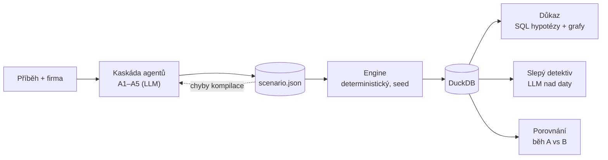
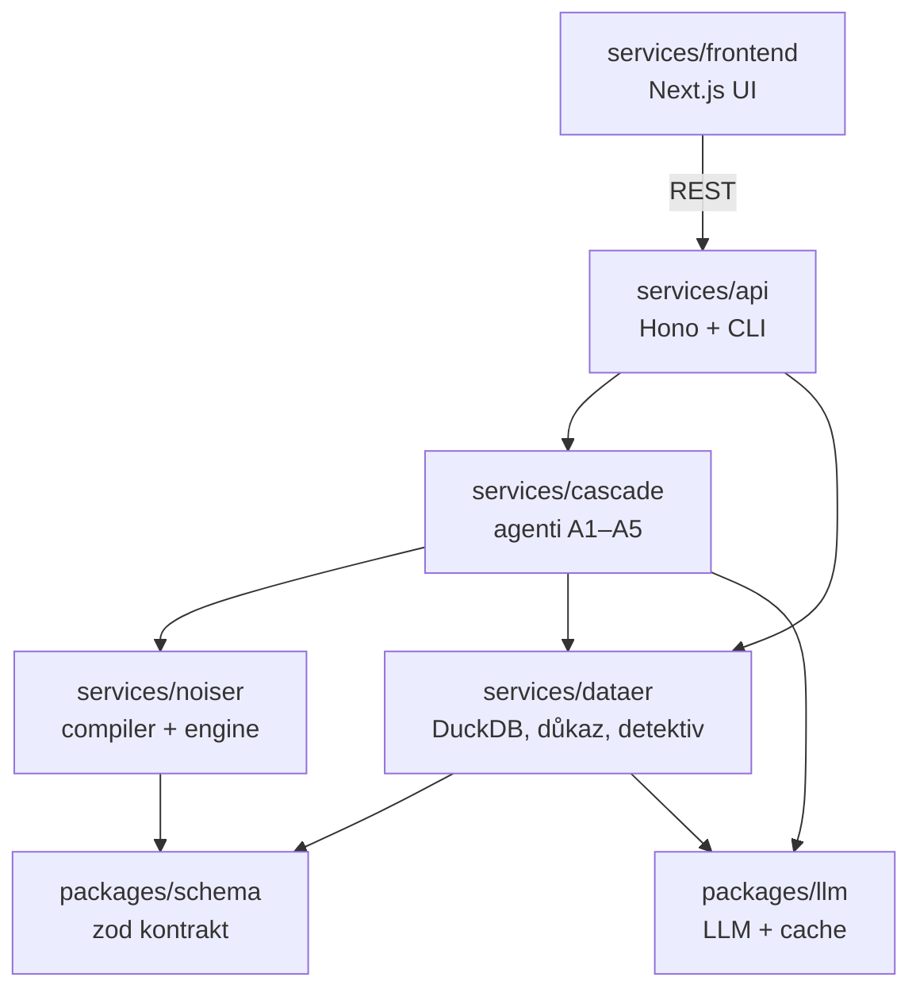

# Story2Data — 4FIS Hackathon 2026

Generátor propojených datasetů, ve kterých je zadaný příběh **kauzálně zapsaný v záznamech**, ne jen popsaný (výzva FIS VŠE).

Zadáš příběh („dodavatel začne v březnu zpožďovat dodávky“) a firmu. Agenti z toho sestaví konfiguraci, deterministický engine z ní vygeneruje tabulky a nezávislé kontroly ověří, že příběh v datech opravdu je.

## Jak to funguje



Tři pravidla, na kterých vše stojí:

1. **LLM píše jen konfiguraci**, nikdy řádky dat ani kód.
2. **Engine je deterministický**: stejný scénář + seed ⇒ stejná data.
3. **Příběh jen přes křivky na parametrech.** Výsledné metriky (tržby, stížnosti) z nich musí vyplynout.

## Struktura repa

Jedna backendová služba (`api`), ostatní služby volá jako obyčejné funkce.



## Start

```sh
pnpm install
cp .env.example .env   # doplň ANTHROPIC_API_KEY
pnpm dev               # API http://localhost:4000, UI http://localhost:3000
pnpm demo              # totéž offline z nahrané LLM cache, bez API klíče
```

## Ověření

```sh
pnpm verify:fast   # hranice + typecheck + lint + unit testy (~30 s)
pnpm verify        # vše včetně formátu, všech testů a buildu
```

## Kam dál

- [SPEC.md](SPEC.md) — specifikace a kontrakt scénáře
- [AGENTS.md](AGENTS.md) — pravidla pro vývoj, git workflow a AI agenty
- [docs/](docs/) — návrh kaskády, demo data, rozhodnutí, gotchas
